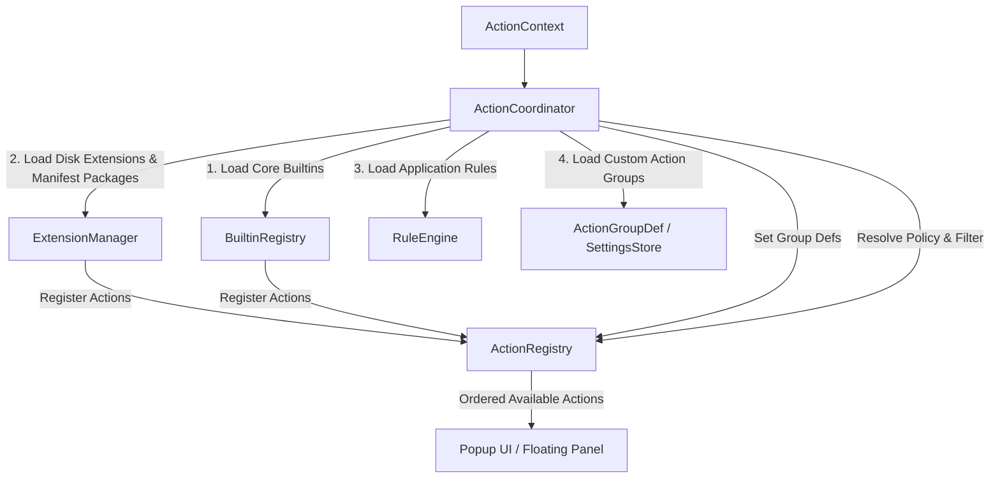

# Action coordinator and registry architecture

The [`ActionCoordinator`](../../Sources/Core/Actions/ActionCoordinator.swift) is the Action Coordinator & Composition layer of OpenClip. It bridges domain managers (`ExtensionManager`, `RuleEngine`) with the central [`ActionRegistry`](../../Sources/Core/Actions/ActionRegistry.swift) catalog, resolving available actions based on user configuration, current text selection, and active application policy rules.

## Architectural responsibilities



1. **Composition Seam**: Initializes domain registries during `loadInitialState()`.
2. **Catalog Storage**: Delegates raw action storage and sorting to `ActionRegistry`.
3. **Policy Context**: App policies are resolved by the trigger sites (`RuleEngine.resolvePolicies`) and attached to the selection context; delivery re-reads them from the snapshot (paste-vs-copy).
4. **Action Reordering**: Exposes reordering primitives (`moveActions(from:to:)`) that mutate user preferences stored via `SettingsStore`.
5. **Custom Action Groups Lifecycle**: Manages user-defined group CRUD operations and synchronization with `ActionRegistry`.

## Action registration mechanics

> Current state (2026-08): the `onRegister`/`onUnregister` callback seam described below is implemented. `ActionCoordinator.loadInitialState()` wires `ExtensionManager` to the registry via those callbacks; the manager never calls `ActionRegistry.shared` directly. GUI-authored custom actions are single-action manifest packages (written by `CustomActionManifestWriter`) and load through the same extension scan, `custom_actions.json`/`CustomActionManager` are retired.

### Initial loading lifecycle

Core builtins (Copy, Cut, Paste, Define, Search, Calculate) are registered first. Application rules load next, then installed extensions (manifests, standalone scripts, snippets) are scanned. Custom action groups load last.

```swift
@MainActor
public func loadInitialState(
    extensionsDirectory: URL = Constants.extensionsDirectory,
    rulesURL: URL = Constants.rulesFileURL,
    dictionaryLookup: @escaping @Sendable (String) -> String? = { _ in nil }
) async {
    let coreBuiltins = BuiltinRegistry.makeCoreBuiltins(
        settingsStore: settingsStore,
        dictionaryLookup: dictionaryLookup
    )
    registry.register(builtIns: coreBuiltins)

    await ruleEngine.loadRules(from: rulesURL)
    await extensionManager.loadExtensions(from: extensionsDirectory)
    loadGroupDefs()
}
```

### Registration and unregistration
When extension packages are added, updated, or removed:
- `ExtensionManager.loadExtensions()` unregisters previous extension actions and reports newly discovered ones through the `onRegister`/`onUnregister` callbacks (wired to the registry by `ActionCoordinator.loadInitialState()`).
- Custom action group definitions (`ActionGroupDef`) in `SettingsStore` persist across extension unregistrations, reloads, and updates. Absent members are dynamically filtered out at runtime by `CustomGroupAction.subActions(in:)` without mutating the saved user configuration.
- Neither Core domain manager touches `ActionRegistry.shared` directly; `ActionCoordinator` is the only type that does.

## Action registry and ordering policy

The [`ActionRegistry`](../../Sources/Core/Actions/ActionRegistry.swift) is responsible for maintaining the in-memory array of registered actions and enforcing sorting order based on user preferences.

### Dynamic ordering math and custom groups

Actions are stored in an internal `@Published` array. Whenever new actions are registered or group definitions change, `sortActions()` evaluates their index against the user's saved preference array (`SettingKey.actionOrder`) using a three-tier ranking:
1. **Tier 0**: Actions explicitly ordered by the user in `SettingKey.actionOrder`.
2. **Tier 1**: Unordered built-in actions (stable insertion order).
3. **Tier 2**: Unordered extensions and other actions (stable insertion order).

When `ActionGroupDef`s are present, `ActionRegistry` injects a synthetic `CustomGroupAction` header followed contiguously by all of its member actions (in their sorted relative order) upon the first member encounter in the base sort.

Group members maintain their **canonical IDs** (e.g. `builtin.copy`, `com.user.ext.action`) without virtual ID prefixing (`vgroup.<id>.<actionID>`).

When users drag to reorder actions in the Preferences UI, `moveActions(from:to:)` re-arranges the items in memory and immediately persists the updated list of action identifiers to `SettingsStore`, filtering out AI presets and synthetic `CustomGroupAction` headers so `actionOrder` only tracks canonical action IDs:

```swift
public func moveActions(from source: IndexSet, to destination: Int) {
    let newOrder = actions
        .filter { !ActionIdentity.isAIPreset($0) && !($0 is CustomGroupAction) }
        .map { $0.id }
    settingsStore.set(.actionOrder, value: newOrder)
}
```

## Custom action groups and lifecycle

Custom action groups allow users to bundle multiple actions under a single expandable popup row.

### Core domain models

- **`ActionGroupDef`** (`Sources/Core/Actions/ActionGroupDef.swift`): Pure Codable model representing the persistent definition (`id`, `title`, `iconName`, `memberActionIDs`), stored as JSON in `SettingKey.actionGroups`.
- **`CustomGroupAction`** (`Sources/Core/Actions/CustomGroupAction.swift`): Pure domain action conforming to `Action` and `SubActionProviding`. It defines `popupBehavior = .showSubActions` and dynamically resolves its sub-actions from the catalog by matching canonical IDs in `memberActionIDs`.

### Group membership rules

A custom group is a folder, not a fixed-size set. There is no minimum of two members. The enforced rule is narrower: a group emptied by a mutation is dissolved, while a group that is empty or single-member by intent is kept.

- `createGroup` accepts zero or more eligible member IDs. A group created empty is kept on purpose: it is a folder the user intends to fill later. Duplicate, blank, or ineligible IDs are filtered, not rejected.
- `updateGroup` stores exactly what the editor saves, including an empty or single-member group.
- A group emptied by a mutation is dissolved. This covers `removeFromGroup`, `addToGroup` moving its last member into another group, and `deleteCustomAction` removing its last member. `saveAndApplyGroupDefs(pruningEmptiedFrom:)` distinguishes a group that had members before the mutation from one that was already empty, so only the former disappears.
- Member IDs that no longer resolve to a registered action are filtered when the group is materialized (`CustomGroupAction.subActions(in:)`) and on mutating saves. An existing member that is merely unregistered this session is retained, so the group survives an extension reload and heals when the action returns. `loadGroupDefs` does not rewrite the saved configuration on boot, and there is no `pruneOrphans` pass.

Pinned by `ActionCoordinatorGroupTests` (`testGroupMembershipContractIsFolderRulesNotAMinimumOfTwo`,
`testAGroupWithNoMembersIsKept`, `testCreateGroupWithSingleMember`,
`testUpdateGroupKeepsGroupWithFewerThanTwoMembers`, `testRemovingTheLastMemberRemovesTheGroup`,
`testUnregisterExtensionRetainsGroupMembershipInDefs`).

## Action availability and context resolution

When selected text is detected, `ActionCoordinator.resolveActions(for:)` converts the raw [`SelectionContext`](../../Sources/Core/Selection/SelectionContext.swift) into an evaluated context using `RuleEngine.resolvePolicies(for:)`.

### Filtering pipeline

`ActionRegistry.availableActions(for:)` applies multiple policy filters before returning actions to the UI:

1. **Disabled Actions Check**:
 - Queries `SettingKey.disabledActionIDs` from `SettingsStore`.

2. **Disabled Package Check**:
 - Queries `SettingKey.disabledPackages` from `SettingsStore`. Any action whose `action.chrome.source` is `.extensionPkg(packageID:)` with a disabled packageID is filtered out (whole-package disable).

3. **Action Capability Check**:
 - Evaluates `canPerform(action, in: context)`. Script actions check for non-empty text, URL templates evaluate optional regex pattern matches, and clipboard-fallback selections require live selection capabilities.

4. **Group Member Visibility Check**:
 - **Extension Groups**: Sub-actions whose IDs match an extension group prefix (`<groupID>.<subID>`) are hidden if the parent group is disabled or filtered out.
 - **Custom Groups**: Member actions mapped via `customGroupMemberToGroupID` are hidden if their parent `CustomGroupAction` is disabled or filtered out.

```swift
public func availableActions(for context: ActionContext) -> [any Action] {
    let disabledIDs = settingsStore.get(.disabledActionIDs)
    let disabledPackages = settingsStore.get(.disabledPackages)

    func passes(_ action: any Action) -> Bool {
        if ActionIdentity.isAIPreset(action) { return false }
        if action is GatedExtensionAction { return false }
        guard canPerform(action, in: context) else { return false }
        if disabledIDs.contains(action.id) { return false }
        if let packageID = ActionIdentity.extensionPackageID(of: action), disabledPackages.contains(packageID) {
            return false
        }
        return true
    }

    // Group sub-actions are only reachable through their group's sub-menu. A group whose
    // row is disabled (or otherwise not visible) hides its sub-actions entirely, so a
    // disabled group never leaks its sub-actions into the bar.
    let groupRowIDs = actions
        .filter { $0.chrome.popupBehavior == .showSubActions }
        .map { $0.id }
    let enabledGroupIDs = Set(
        actions
            .filter { $0.chrome.popupBehavior == .showSubActions }
            .filter { passes($0) }
            .map { $0.id }
    )

    // Custom group members keep canonical IDs, so they are hidden through the explicit memberActionIDs list, not a prefix.
    let customGroupMemberToGroupID: [String: String] = {
        var map: [String: String] = [:]
        for def in groupDefs {
            for memberID in def.memberActionIDs {
                map[memberID] = def.id
            }
        }
        return map
    }()

    return actions.filter { action in
        guard passes(action) else { return false }
        if let groupID = groupRowIDs.first(where: { action.id.hasPrefix($0 + ".") }),
           !enabledGroupIDs.contains(groupID) {
            return false
        }
        if let owningGroupID = customGroupMemberToGroupID[action.id],
           !enabledGroupIDs.contains(owningGroupID) {
            return false
        }
        return true
    }
}
```
