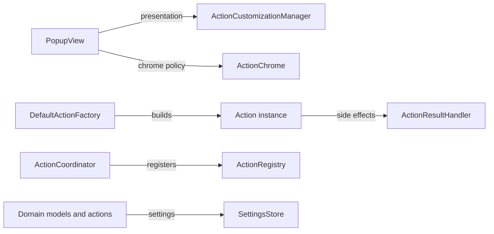

# Architecture overview

OpenClip is split into two targets, and each cross-cutting concern has exactly one owner. That keeps pure domain logic, platform side effects, action runtimes, and UI from leaking into each other.

## Target split

The codebase has two main targets:

```mermaid
flowchart TD
  W[OpenClip workspace] --> C[Core: framework and Swift package]
  W --> A[OpenClip: macOS app target]
  C --> C1[Domain models: Action, ActionChrome, ActionResult, SelectionContext]
  C --> C2[Selection contracts: TextRetrieving, SelectionMonitoring]
  C --> C3[Action catalog and ordering: ActionRegistry, ActionCoordinator]
  C --> C4[Action search and popup mode: ActionSearch]
  C --> C5[Typed settings: SettingsStore, SettingKey]
  C --> C6[App policy rules: AppRule, RuleEngine]
  C --> C7[Snippet and manifest parsing: OpenClipSnippetParser, ExtensionManifest]
  A --> A1[AppKit panels and SwiftUI: PopupPanel, PopupView, PreferencesView]
  A --> A2[Action runtimes: JavaScriptAction, AppleScriptAction]
  A --> A3[Side effects: ActionResultHandler]
  A --> A4[Action factory: DefaultActionFactory]
  A --> A5[Selection monitoring: MacSelectionMonitor, SelectionRetrievalCoordinator]
  A --> A6[Composition root: AppDelegate]
```

### Core target constraints

- Core has no AppKit or SwiftUI dependencies in `Sources/Core/Actions/` or `Sources/Core/Settings/`.
- It uses plain Swift: value types, protocols, and decoupled services.
- Components that need settings take a `SettingsStore` in their initializer, defaulting to `DefaultSettingsStore.shared`. Built-in actions (`SearchAction`, `CalendarAction`, `CalculateAction`) get the store through `BuiltinRegistry.makeCoreBuiltins(settingsStore:)`. `ActionCoordinator` takes `registry`, `ruleEngine`, `extensionManager`, and `settingsStore` in `init`, each defaulting to `.shared`. Title and icon resolution goes through an injected `ActionPresenting`, not a hidden singleton inside the `Action` protocol extension.

## Subsystems

Each cross-cutting concern has one entry point, and code must not bypass it.

### 1. Settings: [`SettingsStore`](../../Sources/Core/Settings/SettingsStore.swift)

- **Owns:** persistence and retrieval of app settings.
- **How:** through strongly typed [`SettingKey<T>`](../../Sources/Core/Settings/SettingKey.swift) instances.
- **Rule:** no direct `UserDefaults.standard` calls anywhere in `Sources/`. Everything goes through `SettingsStore`, injected in Core or reached through `DefaultSettingsStore.shared` in the app target. The only raw access left is the one-time `aiCloudAPIKey` migration in `AIServiceManager` (read, then delete), plus the AI-config and theme `@AppStorage` surface. Migrating the rest is ongoing, so don't add new direct call sites. Secrets such as the cloud AI API key live in `SecretStore` (`~/.openclip/secrets.json`, POSIX 0600), never in UserDefaults.

### 2. Action presentation: [`ActionCustomizationManager`](../../Sources/Core/Actions/ActionCustomizationManager.swift)

- **Owns:** display titles and icons for a UI surface (`.popup` or `.table`).
- **How:** `ActionCustomizationManager.presented(action, surface:)` looks up user customizations and falls back to the action's defaults. `ActionPresentationModel` carries the resolved title and icon.
- **Rule:** UI code never picks icons with type checks or string matches. Preferences table icons use `ConfigurableAction.preferenceIconName`.

### 3. Action chrome policy: [`ActionChrome`](../../Sources/Core/Actions/ActionChrome.swift)

- **Owns:** UI policy metadata for an action, without coupling UI to logic.
- **Fields:**
  - `badge`: `.none`, `.script`, `.url`, `.custom`, `.extensionPkg(String)`
  - `rowStyle`: `.standard`, `.actionGroup`
  - `popupBehavior`: `.perform`, `.showSubActions`, `.provideCompletions`
  - `source`: `.builtin`, `.custom`, `.extensionPkg(packageID: String)`
- **Rule:** views read `action.chrome.badge` or `action.chrome.source` instead of checking `if action is ScriptAction` or matching `action.id`.

### 4. Action factory: [`DefaultActionFactory`](../../Sources/OpenClip/Platform/Extensions/DefaultActionFactory.swift)

- **Owns:** creating executable `Action` objects from extension manifest JSON or parsed snippet headers.
- **How:** it implements the `ActionFactory` protocol in the app target, where the JavaScript, AppleScript, and process runtimes are available.

### 5. Action result handler: [`ActionResultHandler`](../../Sources/OpenClip/Platform/Effects/ActionResultHandler.swift)

- **Owns:** the platform side effects an action returns: copying text, pasting into the active app, opening URLs, and showing system sharing services.
- **Rule:** `PopupWindowController` handles window presentation and event filtering and leaves every result side effect to `ActionResultHandler`.

### 6. Action coordinator and composition: [`ActionCoordinator`](../../Sources/Core/Actions/ActionCoordinator.swift)

- **Owns:** loading the initial state, registering built-ins, and connecting extensions on disk (including manifest packages made in the GUI) to the central `ActionRegistry`.
- **Rule:** `ExtensionManager` doesn't talk to the registry directly. It reports changes through `onRegister` and `onUnregister` callbacks that `ActionCoordinator.loadInitialState()` wires up.
- **Search catalog:** `ActionCoordinator.searchCatalog` (backed by `ActionRegistry.searchCatalog`) is what the popup's action-search palette may offer. It's the registered catalog minus anything switched off in settings (a single action, a whole package, the members of a disabled group, an AI preset turned off) and minus anything that can't run in the current context. In effect it applies the bar's visibility rules to a flat, unpaginated list, and [`ActionSearch.search`](../../Sources/Core/Actions/ActionSearch.swift) ranks it.

## Design guidelines

1. **Accept dependencies, don't create them.** Core types take `SettingsStore` in `init(settingsStore:)` with a default (see §1 above). `ActionCoordinator` and the built-in builder take their collaborators in `init`.
2. **No `ActionRegistry.shared` inside domain managers.** They report registration changes through `onRegister` and `onUnregister` callbacks wired by `ActionCoordinator`. Only `ActionCoordinator` touches the registry directly.
3. **No `switch action.id` string matching in UI.** Display formatting uses `ConfigurableAction.preferenceIconName` and `ActionChrome`.
4. **Pure snippet parsing.** `OpenClipSnippetParser` is a plain string parser with no UI or `@MainActor` ties (it is nonisolated).
5. **Pure layout math.** `PopupPositioner` is a static struct that computes panel coordinates and clamps them to screen edges.
6. **Static previews don't share live state.** `PopupPreview` hardcodes a standard action set and passes its own `PopupHoverState()` and `isStatic: true` to `PopupView`, so it never shows the real popup's state and hovering it never leaks into the real popup.
7. **Standard windows unless a chrome-less card is the goal.** Preferences uses standard window chrome (`hiddenTitleBar` and `fullSizeContentView`) with `.glassSurface` content. Onboarding is a `.borderless` transparent window that redraws the card, border, and shadow itself.
