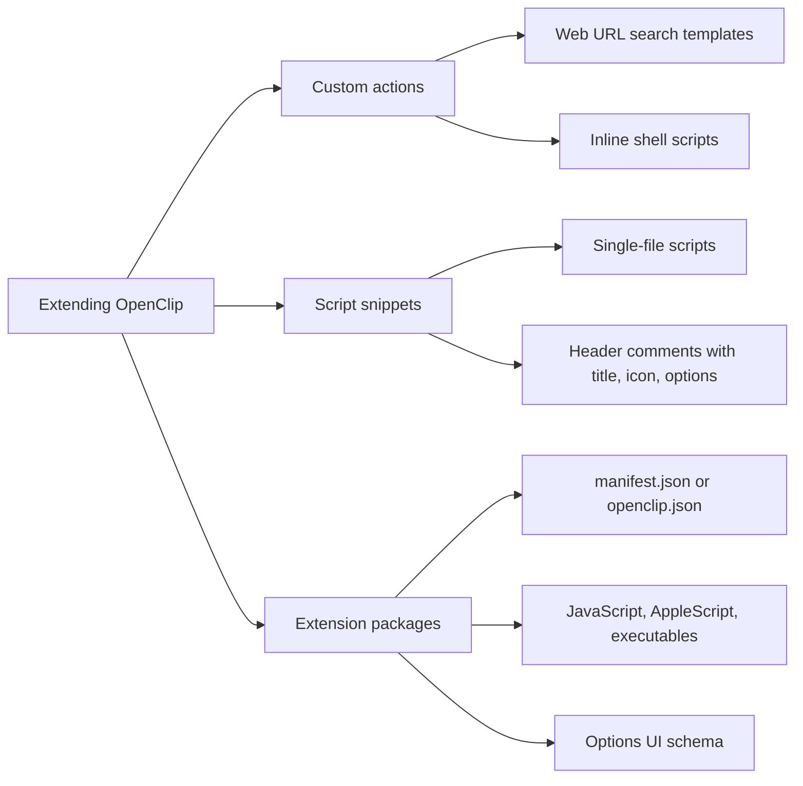
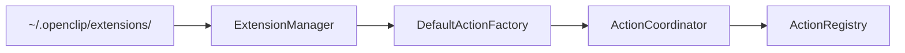

# Extending OpenClip

> Start here: the self-contained authoring guide is [`Extensions/AGENTS.md`](../../Extensions/AGENTS.md). It covers the manifest schema, every action kind, options and requirements, groups, and the result surface. This page is a short orientation.

OpenClip has a pluggable extension architecture. You can use it to add your own text tools, connect third-party APIs, and automate macOS workflows.

## Ways to extend OpenClip

There are three, from simplest to most capable:



1. Custom actions are set up in the app. They are web URL search templates or inline shell scripts (bash, zsh, python, node).
2. Script snippets are single files (`.sh`, `.py`, `.js`, `.applescript`). Comments in the header declare the title, icon, and options.
3. Extension packages (`.openclipext`) are directories containing `manifest.json` or `openclip.json`. They can run JavaScript (JSContext), AppleScript (NSAppleScript), or executables, and they can define an options UI with strings, booleans, and dropdowns.

## Action types

| Action type | Runtime | Typical use |
| :--- | :--- | :--- |
| URL Template | `URLTemplateAction` | Web searches, documentation lookup, deep links |
| JavaScript | `JavaScriptAction` (JavaScriptCore) | Fast string transformations, JSON formatting, web API calls |
| AppleScript | `AppleScriptAction` (NSAppleScript) | Automating macOS apps such as Finder, Safari, Notes, and Mail |
| Executable script | `ScriptAction` or shell `CustomAction` | Python, Node.js, Ruby, and Zsh scripts that use command-line tools |
| Key press | `KeyPressAction` (`type: "keyPress"`) | Sending a synthetic key event such as `"command+shift+v"` to the frontmost app |
| Shortcut | `ShortcutAction` (`type: "shortcut"`) | Running a macOS Shortcut through `/usr/bin/shortcuts` |
| Service | `NamedServiceAction` (`type: "service"`) | Showing the macOS Services menu |
| Group | `GroupAction` (`type: "group"` plus `subActions`) | A menu row that opens a submenu of actions |

## Where extensions live

OpenClip scans this folder at launch for extensions and script files:

```text
~/.openclip/extensions/
├── my-extension.openclipext/
│   ├── manifest.json
│   ├── main.js
│   └── icon.png
├── currency-converter.py
└── format-sql.sh
```

## How extensions plug in

Adding an extension doesn't mean changing Core framework code:



1. [`ExtensionManager`](../../Sources/Core/Extensions/ExtensionManager.swift) parses the manifests and snippets it finds in `~/.openclip/extensions/`.
2. It passes each extension's metadata to [`DefaultActionFactory`](../../Sources/OpenClip/Platform/Extensions/DefaultActionFactory.swift), which builds the action instances.
3. [`ActionCoordinator`](../../Sources/Core/Actions/ActionCoordinator.swift) registers them with [`ActionRegistry`](../../Sources/Core/Actions/ActionRegistry.swift).
