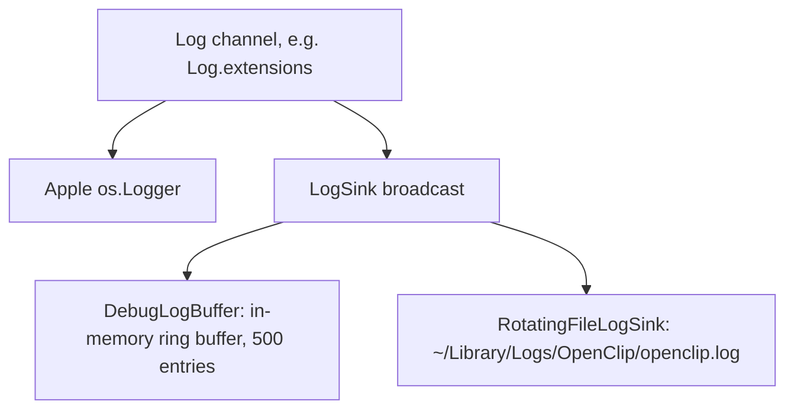

# Logging

All OpenClip logging goes through one surface, `Log` (`Sources/Core/Log.swift`). Every message belongs to a stable category you can grep, and you can filter by category from the command line, the log files, or Console.app. There is no ad-hoc `print()` anywhere in `Sources/`.

## How a message travels

A call like `Log.<category>.<level>(...)` is formatted as a `LogMessage` and sent to three sinks:



1. **Apple `os.Logger`** (the unified logging system) adds almost no overhead and lets you read logs in `Console.app`, `log stream`, and `log show`.
2. **The in-memory ring buffer** (`DebugLogBuffer` and `DebugLogStore`) is a thread-safe FIFO that holds 500 entries. It returns a snapshot instantly for the `--dump-logs` CLI tool, crash reports, and in-app diagnostics, and it needs no background polling of `OSLogStore`.
3. **The rotating file appender** (`RotatingFileLogSink`) writes entries to `~/Library/Logs/OpenClip/openclip.log`. It formats the timestamp and writes each line on a serial queue (`com.openclip.log.fileappender`, QoS `.utility`), so `record` does no formatting on the caller's thread. At 5 MB it rotates, keeping up to three backups (`openclip.1.log`, `openclip.2.log`, `openclip.3.log`).

## Core protocol and types

- **`LogSink` protocol**: Any consumer conforming to `LogSink` can receive log events:
  ```swift
  public protocol LogSink: Sendable {
      func record(date: Date, category: String, level: LogLevel, message: String)
  }
  ```
- **`LogChannel`**: A named logger struct wrapping category metadata and `os.Logger`. Provides convenience methods (`debug`, `info`, `notice`, `warning`, `error`, `fault`, `log(level:_:)`) taking a `LogMessage`.
- **`LogLevel`**: Enum defining severity cases: `.debug`, `.info`, `.notice`, `.warning`, `.error`, `.fault`. Implements `Comparable` (based on priority 1 through 6) and provides `osLogType` mappings.
- **`LogMessage`**: Supports string interpolation with optional `LogPrivacy` specifiers (`.public`, `.private`, `.auto`).
- **`Log.addSink(_:)` & `Log.removeAllSinks()`**: Dynamic, thread-safe registration of sinks.

## The `Log` enum and categories

Each subsystem owns a dedicated `LogChannel` property on `Log` under the `com.openclip` subsystem:

| Category         | Owns                                                        |
| :--------------- | :---------------------------------------------------------- |
| `settings`       | `SettingsStore` paths, rule load/save, launch-at-login, `SecretStore` persistence, installed-app scanning |
| `presentation`   | popup/panel UI, hover, action-run error surfacing, status bubbles |
| `chrome`         | popup window chrome & sizing (currently unused, reserved)  |
| `factory`        | action factory, extension manifest authoring (Add/Edit sheets) |
| `result-handler` | post-action effect handling (paste, calendar write, etc.)   |
| `coordinator`    | action coordination / enablement evaluation                 |
| `shell`          | `ShellProcessRunner` (subprocess watchdog, timeout)         |
| `js`             | `OpenClipJSHost` runtime                                    |
| `selection`      | `SelectionRetrievalCoordinator` + strategies / `MacSelectionMonitor` (gate decisions, window gesture rejection, gesture-locality rejection, Electron `AXManualAccessibility` set results, mode routing, AX + pasteboard + keyboard retrieval); `AutomaticCopyCapture` authorization skips and posted copy triggers (PID only); `PasteAvailabilityProbe` limit and time-limit results |
| `extensions`     | `ExtensionManager`, remote installer, extension store/onboarding install & uninstall, **manifest decode/validation rejections** |
| `ai`             | AI providers and preset persistence                         |
| `permissions`    | TCC / accessibility permission management                   |
| `icons`          | icon fetching/caching (`UnifiedIconProvider`, icon picker)  |
| `updates`        | Sparkle software updates, background check events, update notifications |

Add a new category when a new subsystem starts logging. Never create a raw
`Logger(subsystem:category:)` at the call site, extend `Log` and keep this table in step.

## Conventions

- Levels:
  - `.notice`, lifecycle transitions (install/uninstall, download start/success, permission fallbacks).
  - `.info`, durable, useful state (rules loaded/saved counts).
  - `.error`, recoverable failures that still surface to the user (manifest write failure, action throw).
  - `.fault`, reserved for multi-process crashes / invariant violations (currently none).
  - `.debug`/`.warning`, diagnostic detail and soft failures (defensive parses, transient network).
- Structured and greppable: include the action id, extension id, and/or error domain. e.g.
  `Log.extensions.error("Failed to load extension from \(path): \(error)")`.
- Privacy: anything touching selected text, clipboard content, or extension-authored data stays
  default-private. Only ids and URLs are marked `privacy: .public` (e.g.
  `\(action.id, privacy: .public)`). Do not mark user text `.public`. JS script `console.log` arguments
  are redacted into structural metadata (`<string len=N>`, `<Object keys=[...]>`) before logging.
- No hot-path logging: never log in per-mouse-move hover updates or high-frequency view bodies.

## Viewing and filtering workflows

### 1. File logs (`~/Library/Logs/OpenClip/openclip.log`)

OpenClip automatically logs all entries to disk:

```sh
tail -f ~/Library/Logs/OpenClip/openclip.log

grep "extensions" ~/Library/Logs/OpenClip/openclip.log
```

### 2. Apple Unified Logging (`log stream` / `log show` / Console.app)

All categories share subsystem `com.openclip`:

```sh
log stream --predicate 'subsystem == "com.openclip" && category == "extensions"'

# Debug builds only (release strips info-level spam); include level
log stream --predicate 'subsystem == "com.openclip" AND category == "selection" AND messageType >= 1'

log show --predicate 'subsystem == "com.openclip"' --last 1h
```

In Console.app: filter `subsystem == "com.openclip"`, then narrow by category.

### 3. `--dump-logs` CLI tool

OpenClip provides a fast, built-in CLI log reader powered directly by `DebugLogStore` and `DebugLogBuffer`:

```sh
"/path/to/OpenClip.app/Contents/MacOS/OpenClip" --dump-logs --category=extensions --level=error
```

- No indexing delay (0 ms): log entries are written directly to the in-memory buffer at emission time, so they are queryable at once, without waiting for macOS unified log ingestion or indexing.
- No polling overhead: normal app operation has zero polling timers or `OSLogService.xpc` CPU usage.
- Flags: `--category=`, `--level=`, `--count=`, `--collect=` (seconds, default 4), `--help`.
- It cold-launches the app, runs extension loading (so load/reject lines are produced), waits for collection, prints matching lines to stdout, and exits 0 (`2` on usage errors). This is the quickest agent check for "did my extension load or reject?".

### Selection log noise and correlation

Selection retrieval emits one `selection completed` event for each read, including fast
native successes. The summary carries the request trace ID, trigger, bundle ID,
configured and winning strategies, outcome, attempt count, fallback reason when applicable,
and timings/retry counts for phases that ran. Timings are in microseconds. AX inspection
time is also included within web/evidence settling durations; these overlapping measurements
must not be summed to estimate total latency.

Successful reads log at info. Empty/blocked reads log at debug, cancellations at trace,
and changed targets, timeouts and failures at warning. Repeated AX inspections, strategy
transitions, menu evaluation, copy polling detail and successful strategy messages log at
trace, excluded by the app's default debug sink. Cascade reports still reach diagnostics
consumers, but the app sink does not print a second report summary.

Copy capture inherits a task-local request trace (including detached menu dispatch).
Monitor/hotkey delivery logs keep the read's trace ID for fallback or invalidated delivery,
and record blocked presentation decisions while omitting redundant successful delivery.
`clipboardRestored` is included only
when synthetic copy was posted; false means no baseline restoration occurred, including
intentional preservation of a user copy. No selected text or clipboard contents enter the
summary.

Example (fields are sorted in actual output):

```text
[Trace#10] [cascade] selection completed [outcome=selection trigger=dragEnd configuredStrategy=ax-text-control winningStrategy=keyboard-copy elapsedMicros=453000µs webAreaRetries=5 evidenceRetries=2 clipboardRestored=true]
```

### Fullscreen selection / popup diagnostics

`SelectionContext.traceID` carries the retrieval ID through mouse, hold, keyboard and
fresh hotkey reads, cached selections, and context transformations. Search for `[Trace#N]`
in `~/Library/Logs/OpenClip/openclip.log` across both `selection` and `presentation`.
Native Copy refusals log the generation-match result and source/frontmost PIDs, never
selection contents. Overlay refusal logs identify the same input-capable window used by
the gate, excluding WindowServer shields that cannot receive Copy.
Include the approximate time when reporting a trace: IDs restart with the app; presentation
records include the process ID and popup session UUID. `Trace#0` denotes an untracked
context (for example OCR or a standalone clipboard palette), not a retrieval trace.

The chain records retrieval completion, non-success monitor outcomes and blocked
presentation decisions. Routine paste-probe progress and successful popup lifecycle logs
are omitted. Placement failures and recovery retain detailed window metadata.
Popup records include visibility, active-Space membership, occlusion, source/frontmost app
IDs, app activation, key-window state, hide-on-deactivate, frame, mode and session age.
Two session-scoped checks run 150 ms and 750 ms after ordering. Occlusion/dismissal
events log only for an off-Space or recovering panel. These are bounded checks, not
continuous polling. Window metadata does not prove that pixels reached the display.

Toast windows have the same fullscreen eligibility as the main popup. If a toast is invisible
or off the active Space after its bounded visibility check, `Recovering toast window` records
visibility and Space membership at notice level under `presentation`. It contains no feedback
message or captured text. Recovery replaces the window once without resetting its dismissal timer.

For an off-Space or recovering panel, `hide()` records its caller function and line
(or explicit reason) before clearing the session. The first delayed check
attempts one guarded Space-membership recovery when a visible non-key action popup remains off the active Space with its source still frontmost.
`space-recovery-start` and `space-recovery-recreated` mark the retry with a new panel
window at notice level. The second check logs `space-recovery-unresolved` at warning
if still off-Space, or `space-recovery-verified` when it reaches the active Space.
The latter confirms membership, not user-observed visibility. A new show or hide
invalidates stale checks. No selection text,
clipboard payload, window title, or document content is logged.
